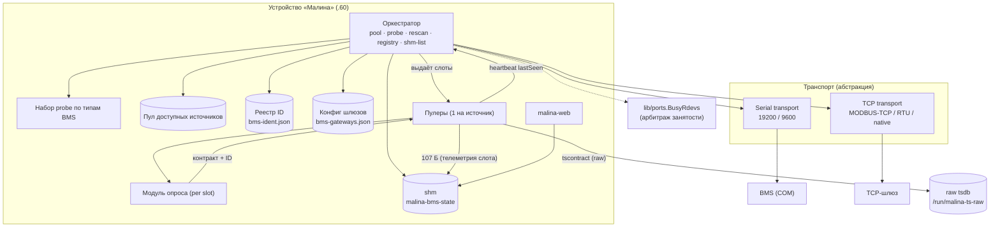
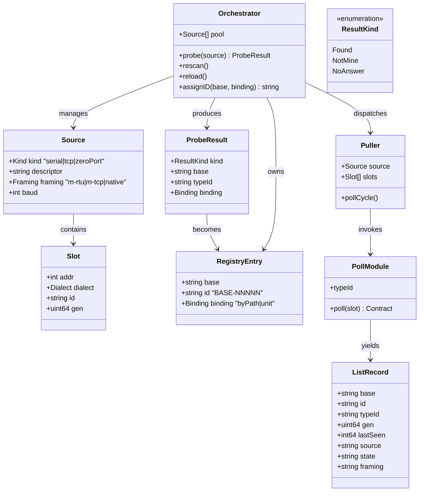
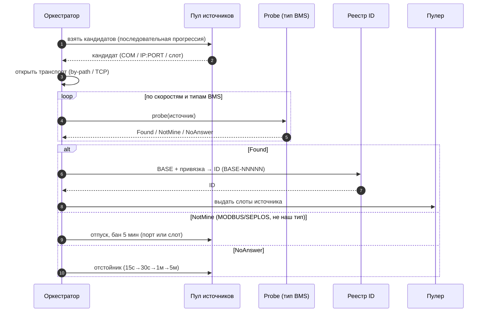
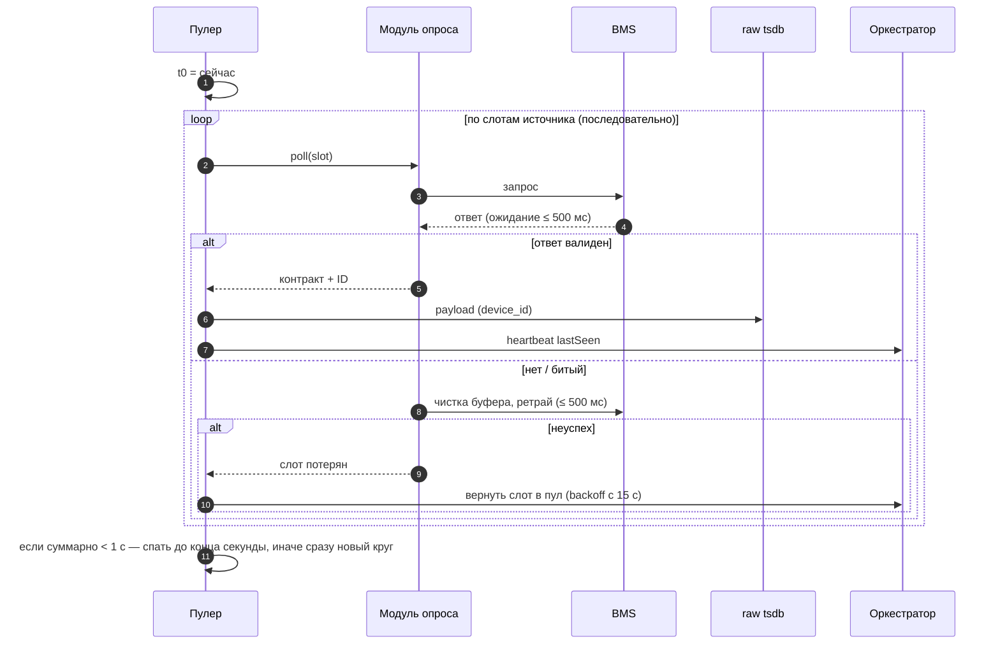
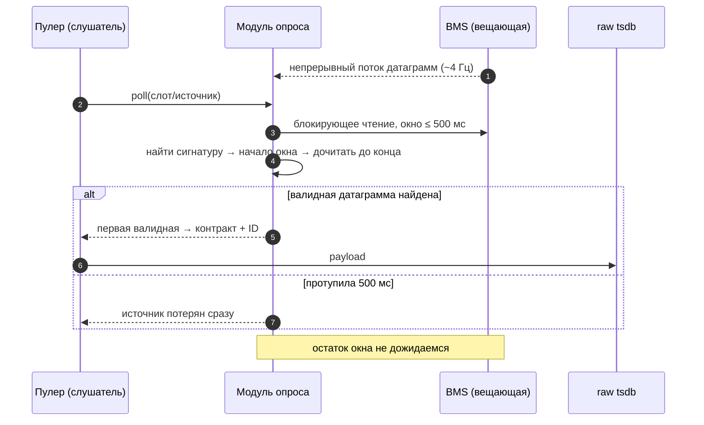
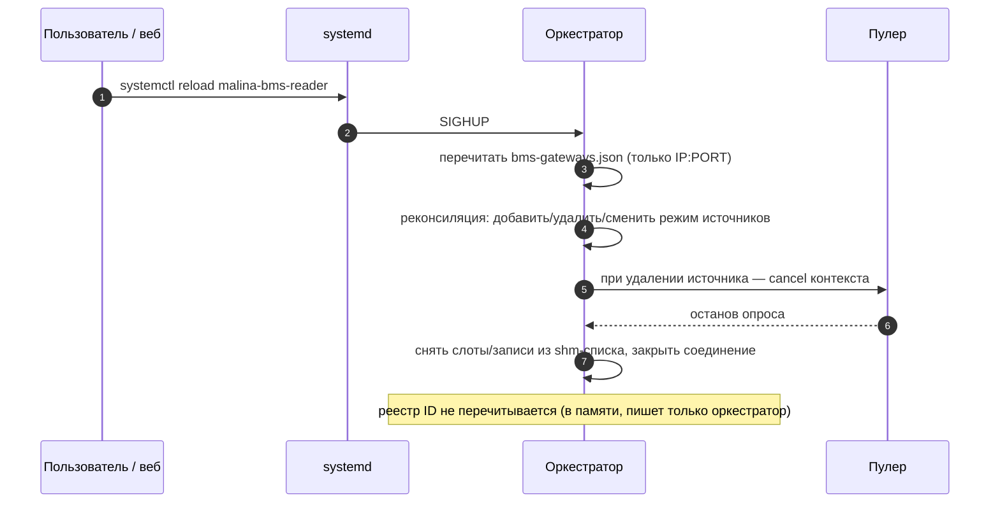
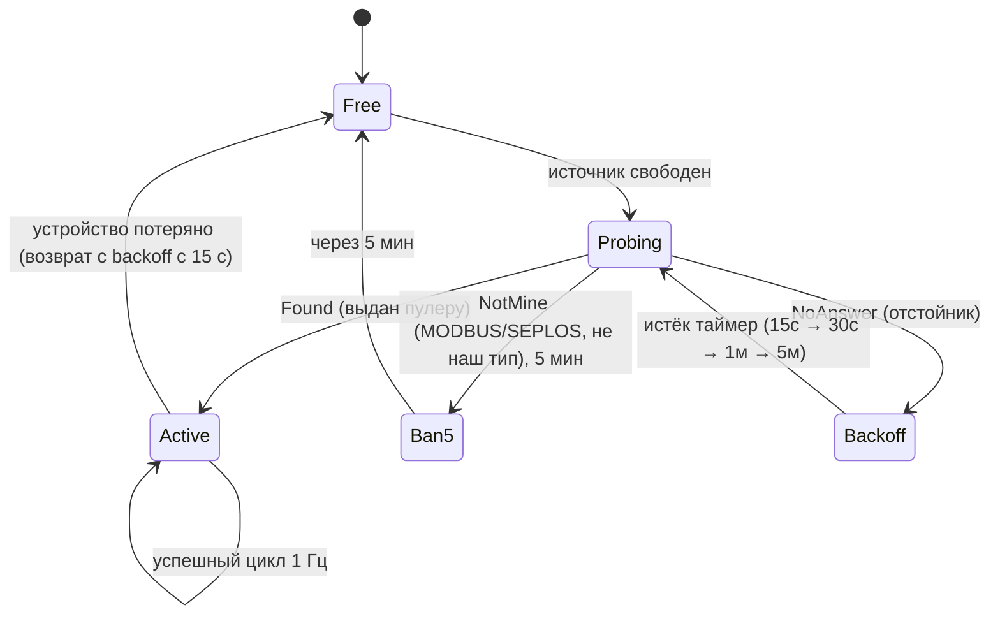
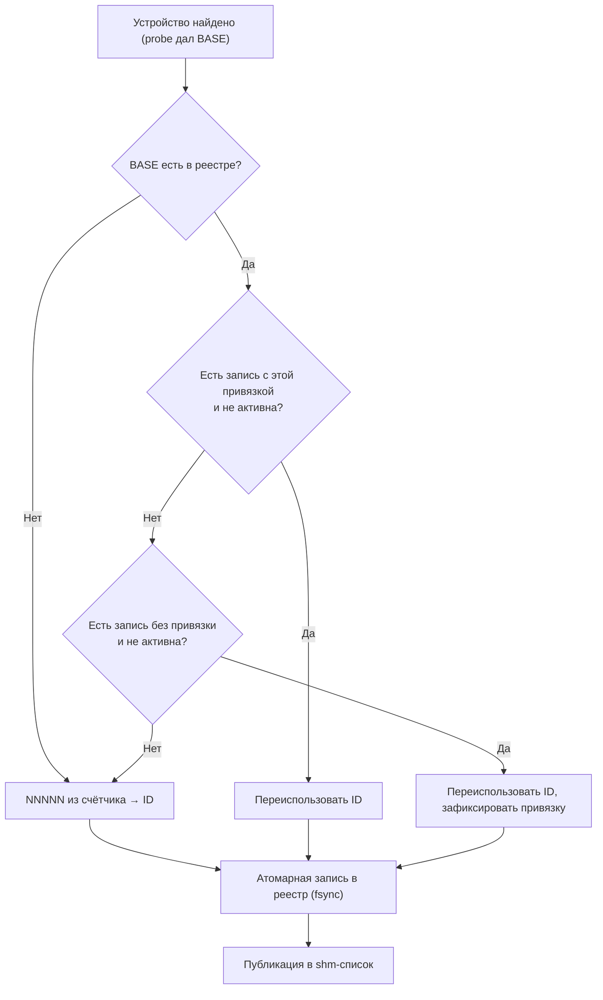
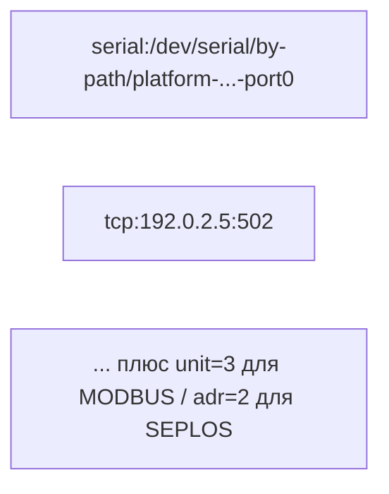
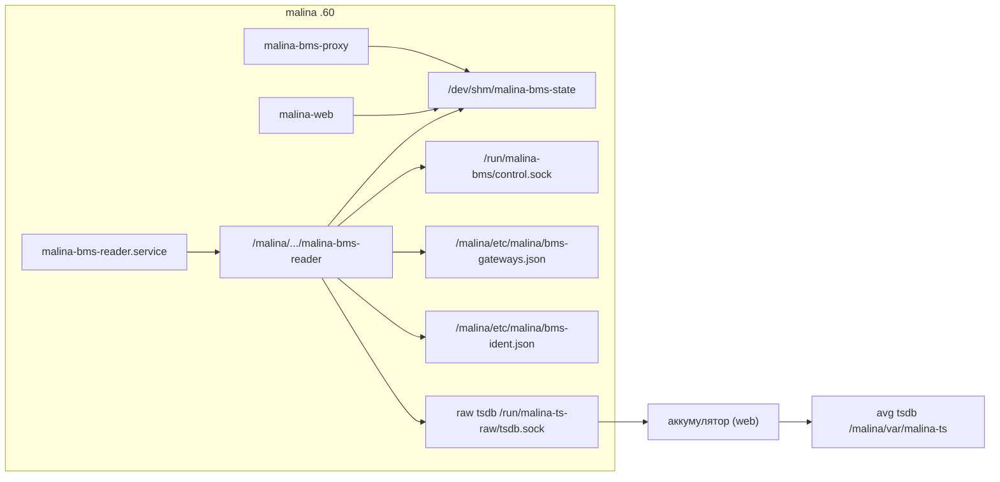

# BMS-Receiver: архитектура и взаимодействие компонентов

**Статус:** архитектура **закрыта** (ревью завершено 2026-10-15).
**Реализация — только по отдельной отмашке.** Состав контракта BMS — **отдельный
следующий этап** (§11).

> **Правило для агентов.** В раздел **«Архитектура»** (и в принятые архитектурные
> решения) изменения **не вносить без явного разрешения автора**. Любая правка
> архитектуры — только по прямой отмашке автора.

**Связанные документы:** `docs/stat.md` (внутренние контракты телеметрии),
`docs/telemetry-store.md` (хранилище рядов), `docs/map-reader.md` /
`docs/kes-reader.md` (каркас сканера и опроса), `docs/daemons-shared.md` (общая
библиотека `daemons/lib`).

---

## 1. Назначение и границы

**Назначение.** Демон `bms-reader` собирает телеметрию **BMS** (battery management
system) разных типов и протоколов и публикует её во внутреннем контракте телеметрии
для хранения (tsdb) и отображения в веб-админке.

**В границах:** COM-порты (USB-serial) и TCP-шлюзы; мультиустройственность на шине
(адресация MODBUS/SEPLOS); динамический состав устройств; публикация списка (shm) и
телеметрии (raw tsdb); настройка шлюзов через веб и перечитывание по сигналу.

**Вне границ:**

- конкретный состав полей контракта и список поддерживаемых типов/диалектов BMS
  (§11 — следующий этап);
- **два мастера на одной физической шине** (МАП/КЭС + BMS на одной RS485 на разных
  `unit`) — **не поддерживается**: владение шиной исключительное;
- тираж/запекание образа.

**Общий слой `daemons/lib`.** Берём: `ports` (BusyRdevs/ListPorts/RdevOf),
`transport` (serial; + наш TCP-транспорт через тот же интерфейс), `shm`, `control`,
`stat` (модуль сохранения raw), `tscontract`, `device`. **Свой** — оркестратор и пул
источников: `lib/scanner.Runner` заточен под serial+rdev (нет TCP-источников,
динамического состава слотов, пассивных устройств). Третий самобытный механизм
сканирования не вводится; арбитраж занятости — тот же `lib/ports.BusyRdevs`.

**Отличия от `map-reader`/`kes-reader`:** много типов BMS, несколько устройств на
шине, пассивные (вещающие) устройства, TCP-источники, реестр идентификаторов.

---

## 2. Термины

| Термин | Значение |
|---|---|
| **Оркестратор** | Главный компонент: пул источников, probe, рескан, реестр ID, публикация списка, открытие портов/TCP. |
| **Источник (source)** | Единица владения и опроса: COM-порт или `IP:PORT`. |
| **Слот** | `(источник, адрес)`: конкретное устройство на адресуемой шине (MODBUS `unit` / SEPLOS `ADR`). |
| **Нулевой порт** | Источник с **не-шинным** протоколом (point-to-point native, без адресации) — **всегда 1 устройство**. |
| **Шинный протокол** | Протокол с адресацией на источнике (MODBUS, SEPLOS) — до 16 устройств. |
| **Probe** | Функция распознавания своего устройства для конкретного типа BMS. |
| **BASE** | Строка-идентификатор от probe (серийник BMS / чипа / придуманная комбинация). |
| **ID** | `BASE-NNNNN` — уникальный идентификатор устройства. |
| **`framing`** | Как говорить с источником: `m-rtu` / `m-tcp` / `native` (ставит probe). |
| **Пулер** | Поток, закреплённый за одним источником; опрашивает его слоты, пишет payload в tsdb. |
| **Модуль опроса** | Опрос конкретного слота по протоколу/диалекту; мэппинг в контракт. |
| **Контракт** | Внутреннее представление телеметрии BMS (`device_type = bms`). |
| **Отстойник** | Прогрессия backoff для выпавших источников/слотов. |
| **`Found`** | Устройство опознано как наше. |
| **`NotMine`** | Устройство ответило валидными кадрами **стандартного семейства** (MODBUS/SEPLOS), но логическая проверка probe его не признала (формат серийника, версия ПО). |
| **`NoAnswer`** | Ответа нет (в т.ч. native MicroArt-МАП/КЭС — его probe не опознаёт). |

---

## 3. Компонентная диаграмма



**Ключ:** оркестратор — **единственный** владелец поиска, проб, раздачи и **писатель
shm-списка**; пулеры не знают типов BMS, исполняют опрос выданных слотов и **публикуют
телеметрию слота в shm** (бинарный 107 Б, читает web) и в raw.

---

## 4. Компоненты и ответственности

| Компонент | Ответственность | Не делает |
|---|---|---|
| **Оркестратор** | Пул; перебор-пробы; открытие Serial/TCP; рескан; реестр ID; shm-список; реконсиляция по reload | Не пишет payload телеметрии |
| **Набор probe** | По типу BMS: распознать своё устройство, выдать BASE (≤ 44) | Не опрашивает телеметрию |
| **Пулер** | Опрос слотов источника (1 Гц); слушатель для пассивной; запись payload; heartbeat `lastSeen` | Не разбирается в типах BMS |
| **Модуль опроса** | Опрос слота по протоколу/диалекту; мэппинг в контракт | Не знает про пул/ID |
| **Реестр ID** | BASE ↔ ID, привязки (`by-path`/`unit`), сквозной счётчик | Не хранит телеметрию |
| **shm-список** | Публикация состава BMS для веб | — |

---

## 5. Модель данных (class-диаграмма)



**`gen`** — метка **генерации слота** (как `nextGen`/`PrepareGen` в
`map-reader/slots.go`, `kes-reader/state.go`): `time.Now().UnixMilli()` с гарантией
монотонности (`+1` при совпадении мс), влезает в JS Number. Назначается при **выдаче
слота** устройству — **включая пассивное** (до первой публикации). Не время публикации
и не инкремент на публикацию.

---

## 6. Диаграммы взаимодействия

### 6.1. Обнаружение и выдача источников



### 6.2. Активный цикл опроса (период 1 с)



### 6.3. Пассивный (вещающий) опрос



### 6.4. Рескан шины (отдельный поток) под мьютексом

```mermaid
sequenceDiagram
  autonumber
  participant O as Оркестратор (рескан)
  participant MX as Мьютекс источника
  participant B as Шина
  participant PL as Пулер

  Note over O: период ~30 с (безусловно, может прерывать опрос);<br/>дырки/хвост — по отстойнику
  O->>MX: lock
  Note over PL,B: основной цикл опроса ждёт мьютекс
  O->>B: перечислить адреса (0..N / 1..N), найти дырки и max+1
  B-->>O: найденные устройства
  O->>PL: добавить/убрать слоты (со следующего цикла)
  O->>MX: unlock
```

**Длительность рескана не ограничена 1 с** — зависит от числа поддерживаемых типов BMS
и скорости каждого probe (может быть существенно больше секунды); на это время основной
цикл ждёт мьютекс источника. Таймаут на отсутствующий адрес — **200 мс**. Рескан шины
(перечисление адресов) — **периодический (~30 с, безусловно)**; повторная проба
дырок/хвоста — **адаптивная, по отстойнику**.

### 6.5. Перечитывание настройки (reload)



---

## 7. Жизненный цикл источника / слота



**Примечания:**

- Владение источником **исключительное, но только пока fd открыт**; арбитраж занятости —
  `lib/ports.BusyRdevs` (как у map/kes). **При backoff порт отпускается** (гонок за
  возврат не устраиваем).
- Проба **строго последовательная** (1 одновременно).
- Backoff на запись пула (источник или слот), **сбрасывается при успехе**.
- Устройство, выданное пулеру, backoff не имеет; при потере возвращается в пул.
- **Бан `NotMine`** — на ту запись пула, что ждала: порт целиком → бан порта, слот →
  бан слота.
- **Чужой трафик (`NotMine`) → fd не удерживаем:** источник не принимается, поэтому
  транспорт **закрывается сразу**, порт уходит в бан. Иначе открытый fd блокировал бы
  другой демон на том же порту (напр. `bms-proxy` на общем CH340-адаптере инвертора).

---

## 8. Транспорт, адресация, ёмкость

- **Serial**: владение действует **только пока fd открыт**, делится пулером и ресканом
  под мьютексом; переоткрытие при проблемах без смены скорости. **При backoff порт
  отпускается** — если его заберёт другой демон, значит он его.
- **Скорости** — **список на тип BMS** (не зашито). Текущий набор — **19200 / 9600**
  (решение владельца); при добавлении типов список расширяется на уровне типа.

**Режим шлюза ↔ `framing` (единая таблица):**

| Конфиг (`mode`) | Определяет probe (`framing`) | Как говорит модуль |
|---|---|---|
| `modbus` | `m-tcp` | MODBUS-TCP (MBAP, без CRC) |
| `none` | `m-rtu` | MODBUS-RTU (CRC) поверх TCP-потока |
| `none` | `native` | нативный протокол BMS (напр. SEPLOS) |

`native` в конфиге **не задаётся** — его определяет probe в режиме `none`. **Фолбэков
нет**: probe ставит метку `framing` и закрепляет её за источником; модуль общий для
`m-rtu`/`m-tcp` (разница — заголовки и CRC).

- **Адресация**: MODBUS `unit` с **1**, SEPLOS `ADR` с **0**. Лимиты: **MODBUS 1..16,
  SEPLOS 0..15** — **физический предел 16 устройств на шину**.
- **Нулевой порт** (не-шинный, point-to-point native) — **всегда 1 устройство**.
- **MODBUS и SEPLOS на одной шине не смешиваются**; диалекты одного семейства — можно;
  несколько устройств одного семейства — **один поток, последовательно**.
- **Пассивная шина** — одно вещающее устройство, только слушатель; активному рескану
  **не подлежит**.
- **Распознавание «чужого».** Отдельной MicroArt-пробы **нет** по причине **отсутствия
  функциональной необходимости**: ни `map-reader`/`kes-reader`, ни мы не опознаём чужое
  семейство как своё (MicroArt к тому же не встречается на TCP-шлюзах — чувствителен к
  таймингам). Устройство, не опознанное ни одним probe, — **`NoAnswer`** (отстойник).
  Устройство, ответившее валидными кадрами стандартного семейства (MODBUS/SEPLOS), но не
  наше, — **`NotMine`** (бан 5 мин). Фиксированного бюджета пробы источника **нет**
  (решение владельца): длительность ограничена таймаутами отдельных probe.
- Горутина/пулер **спит между опросами**; для пассивного — **блокирующее чтение** с
  таймаутом окна, без busy-wait.

---

## 9. Идентификаторы и реестр

- **ID = `BASE-NNNNN` всегда** (для всех, включая серийники).
- **BASE** формирует probe: серийник BMS → серийник COM-чипа → придуманное
  (`ТИП-ЁМКОСТЬ` и т.п.); **≤ 44 символа**.
- **`NNNNN`** — **глобальный** сквозной счётчик; хранится в конфиге под мьютексом.
- **ID ≤ 50 символов** (включая `-NNNNN`).
- **Санитайзер BASE** (единая функция probe и `validKey` tsdb): исключаются `/`, NUL,
  управляющие символы, ведущие/хвостовые пробелы, имена `.`/`..`. Whitelist-алфавит не
  вводим (решение владельца: «исключать только то, что ломает ФС/логи/JSON»).
- **Реестр** (персистентный, `/malina`): BASE, ID и привязки (`by-path`, `unit`).
  Дизамбигуаторы коллизий — **только в реестре**, в строку ID не входят.
- **Привязка по `by-path`** — **живёт вечно**.
- **`gen`** — метка генерации слота (`UnixMilli`, монотонная); назначается при выдаче
  слота, **включая пассивные**.
- Серийник перезапрашивается **только после отвала** (повторный probe); в опросе ID
  стабилен.
- **Персист — обязательный и атомарный.** Счётчик `NNNNN` пишется на диск
  **синхронно (temp + rename + fsync файла и каталога) ДО публикации ID**; при сбое номер
  **не переиспользуется**. Запись реестра — только при новых уникальных конфигурациях,
  атомарно.
- **Смена BASE = новое устройство**: BASE изменился → новый ID сразу, **без гистерезиса**.



**Тот же `by-path`, другой BASE** — это другое устройство: новый ID, привязка
`by-path` перезаписывается на новую запись, прежняя запись остаётся в реестре.

---

## 10. Тайминги и периоды

| Параметр | Значение |
|---|---|
| Период опроса | **1 с** (иное — на усмотрение типа) |
| Активный запрос — ожидание ответа | **≤ 500 мс**, ретрай ещё **≤ 500 мс** |
| Пассивная проба/опрос — окно | **≤ 500 мс** (первая валидная; протупила — сразу потеря) |
| Бюджет пробы источника | **нет** (фикс-бюджет убран); ограничение — таймауты отдельных probe |
| Рескан шины (MODBUS/SEPLOS) | период **~30 с (периодический, прерывает опрос)**; **длительность не ограничена 1 с**; таймаут отсутствующего адреса **200 мс**; дырки/хвост — по отстойнику |
| Backoff (отстойник) | 15 с → 30 с → 1 мин → 5 мин (далее 5 мин) |
| Бан `NotMine` | **5 мин** |
| TCP-реконнект | **1 попытка ~0.2 с** |
| Устройств на шину | **≤ 16** (MODBUS 1..16 / SEPLOS 0..15) |
| **Всего устройств** | **16** (глобальный `MaxDevices`, shm на 16 слотов) |
| Не-шинный порт | **1** устройство |
| BASE | **≤ 44 символа** |
| ID (`BASE-NNNNN`) | **≤ 50 символов** |
| Serial-сканирование кандидатов | `scanIdle` 10 с / `scanActive` 1 мин |
| TCP-источники | из `bms-gateways.json` (не сканируются); недоступный шлюз → backoff-лестница 15 с→5 мин |

---

## 11. Контракт телеметрии и tsdb

- **Один `device_type = bms` + версии.** `version` = **ревизия схемы контракта**; реестр
  `tscontract.Registry` ключуется парой `(bms, version)` (как `map` v1/v2/v3). Смена
  набора полей (или числа ячеек, если применимо) → новая версия = другая серия.
- **Состав полей** — отдельный следующий этап: свести разные BMS к единому
  версионированному контракту.
- `device_id` = ID (`BASE-NNNNN`).
- **Расширение tsdb `validKey`:** сейчас режет ключ на **10 байтах** (искусственно;
  провод `str` = u8 длина держит до 255 Б). Поднимаем лимит **до 50** (под ID). Масштаб
  правки: `daemons/tsdb/store.go` (`validKey` — и `Type`, и `ID`), комментарий/проверка в
  `daemons/tsdb/format.go` (seg-заголовок), тесты, мета-лист, UI, `docs/telemetry-store.md`.
- Публикация — через модуль сохранения (raw) как у `map-reader`/`kes-reader`.

### Оценка объёма raw

`объём/сутки ≈ устройств × байт/строку × 86400`. При **16 устройствах**:

| байт/строку | МБ/сутки | влезает в 200 МБ |
|---|---|---|
| 50 | ~69 | да |
| 100 | ~138 | да |
| 140 | ~194 | на грани |
| 200 | ~276 | нет (меньше суток) |

Вывод: глубина истории **зависит от размера payload**; «укладывается в 200 МБ» верно лишь
для компактного контракта (≤ ~140 Б/строку). Для развёрнутого BMS-контракта raw может
заполнить tmpfs **раньше суток** (retention по объёму вытеснит старейшее). Точные числа —
после фиксации контракта.

---

## 12. Публикация состояния (shm)

- **Список** пишет **только оркестратор** (инвариант «один писатель на item», seqlock);
  `lastSeen` оркестратор обновляет **по heartbeat от пулера** (успешный опрос).
- **payload** телеметрии — пишет **пулер**: **в shm** (бинарный 107 Б, per device,
  читает web) **и** в **raw tsdb** (`tscontract`).
- Запись списка: `base`, `id`, `typeId`, `gen`, `lastSeen`, `source`, `state`, `framing`.
- **`source`** — один дескриптор на все варианты (без различия TCP/SERIAL/слота):



---

## 13. Настройка и веб-админка

- **`/malina/etc/malina/bms-gateways.json`** — список `IP:PORT` (+ режим
  `modbus`/`none`). Перечитывается по **`systemctl reload`** (SIGHUP).
- **`/malina/etc/malina/bms-ident.json`** — реестр ID. В памяти оркестратора, пишет
  только оркестратор; **не перечитывается** по reload.
- Оба файла — под мьютексом; запись **атомарная** (temp + rename + fsync).
- При **удалении** шлюза из конфига: cancel контекста пулера → останов опроса → снятие
  слотов/записей из shm-списка → закрытие соединения (§6.5).
- **Страница в веб-админке**: список шлюзов, валидация (`host:port`, дубликаты, режим).
  i18n — все языки проекта (ru/be/zh/en/ka/kk/uz/tg, дефолт en).

---

## 14. Развёртывание



| Что | Значение |
|---|---|
| Демон / бинарник | `bms-reader` / `malina-bms-reader` |
| shm | `/dev/shm/malina-bms-state` (список + до 16 телеметрийных слотов 107 Б); читатели: `malina-web`, `malina-bms-proxy` |
| control-сокет | `/run/malina-bms/control.sock` |
| unit | `malina-bms-reader.service` |
| `device_type` | `bms` |

---

## 15. Нефункциональные требования

- **RO**: модуль опроса строго только читает BMS (никаких записей).
- **Отзывчивость**: потерянные источники отбрасываются быстро (2×500 мс), чтобы не
  тормозить опрос остальных; цикл штатного опроса — не медленнее 1 с (фаза рескана
  **не** ограничена 1 с); для пассивного — **блокирующее чтение** с таймаутом окна,
  без busy-wait.
- **Изоляция**: залипший TCP-шлюз/порт не блокирует остальные (реконнект 1×0.2 с,
  возврат в пул).
- **Персистентность**: реестр/cчётчик — атомарно и **синхронно** (temp+rename+fsync);
  спецзащиты от флаппинга BASE нет (смена BASE = новое устройство).
- **Наблюдаемость**: список устройств в shm для веб; логи демона.

---

## 16. Риски и краевые случаи

1. **Сосуществование с `map-reader`.** Арбитраж — по занятости fd (`lib/ports.BusyRdevs`).
   Устройство, не опознанное ни одним probe (в т.ч. native MicroArt-МАП/КЭС), — **`NoAnswer`**
   → отстойник; но такие порты обычно заняты профильным демоном (порт busy → пропускаем).
   MODBUS-МАП (достижим по MODBUS) не пройдёт логические проверки BMS → **`NotMine`** →
   бан 5 мин. Перебор `unit>1` у `map-reader` идёт только если `unit=1` опознан как МАП
   (`detect.go:58-74`), поэтому «валидный кадр чужого» сам по себе захвата не создаёт.
   Если профильный демон **не запущен/упал**, чужой MicroArt-порт **неотличим от пустого**
   (оба `NoAnswer`) и периодически прощупывается MODBUS/SEPLOS-запросами в цикле отстойника —
   принято. **Non-goal:** два мастера на одной физической шине (МАП/КЭС + BMS) — не
   поддерживается.
2. **Обрыв ряда в tsdb** при смене BASE (ёмкость/порт/серийник): ID меняется → новый ряд.
   Аккумулятор (`malina-web`) усредняет по `device_id`, поэтому avg-история **рассыпается
   на два ряда**, UI (`ui-stat`) их **не сшивает**. Следствие архитектуры ID, осознанно.
3. **Флаппинг BASE** → серия записей на SD и обрывов ряда. Осознанно (гистерезиса нет).
4. **Отпускание порта при backoff** → порт может быть захвачен `map-reader`/`kes-reader`;
   при возврате устройства bms-reader может проиграть гонку. Осознанная плата за
   «не держать fd в простое».
5. **Пассивная шина** и рескан — несовместимы (в неё нельзя слать) — учтено (§8).
6. **Изменение лимита `validKey`** в tsdb — правка контракта хранилища; нужна ревизия
   зависимостей (мета, UI, тесты, `telemetry-store.md`).
7. **Нет фикс-бюджета пробы и рескана**: длительность зависит от числа типов BMS; рескан
   шины периодический (~30 с) и блокирует опрос на своё время — осознанно (решение
   владельца). При расширении числа типов длительность рескана растёт (на будущее —
   возможен мягкий предел частоты рескана шины).

---

## 17. Глоссарий сокращений

- **M-RTU / M-TCP** — MODBUS-RTU / MODBUS-TCP.
- **`NotMine`** — стандартное семейство (MODBUS/SEPLOS), но не наш тип.
- **Отстойник** — прогрессия backoff.
- **Слот** — устройство на адресуемой шине.
- **`gen`** — метка генерации слота (UnixMilli, монотонная).
