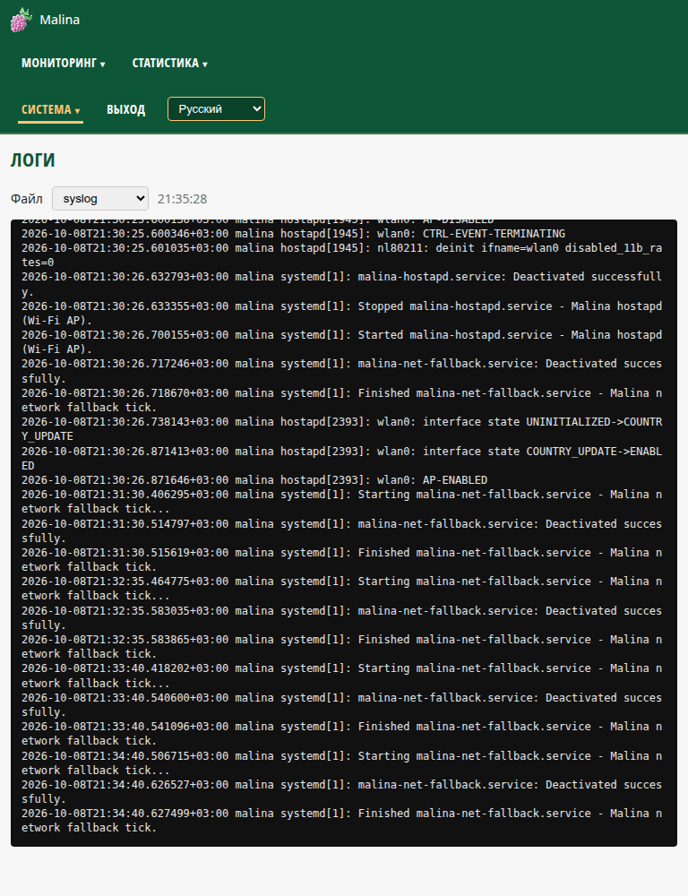

# Логи (`/logs`)

- Выбор файла из списка: `syslog`, `auth.log`, `kern.log`, `user.log`, `cron.log`,
  `mail.log`, `daemon.log`, `messages`, `dpkg.log`.
- Автообновление раз в секунду, пока список прижат к низу; при прокрутке вверх
  подгружается история (постранично).
- Режим только для чтения; защита от выхода за пределы каталога логов.
