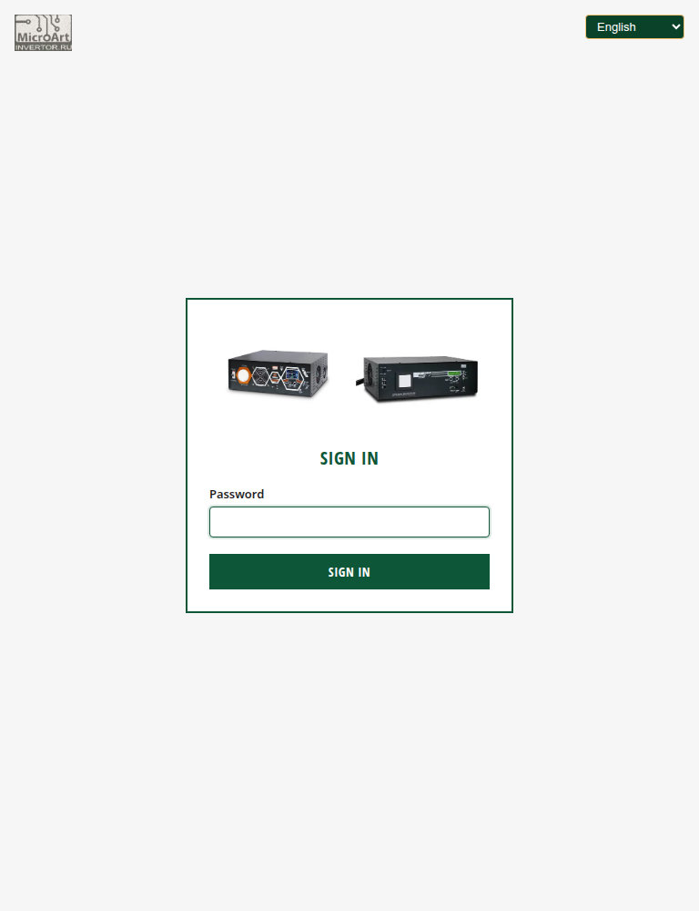
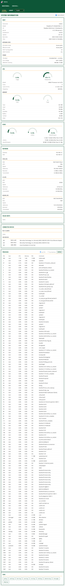
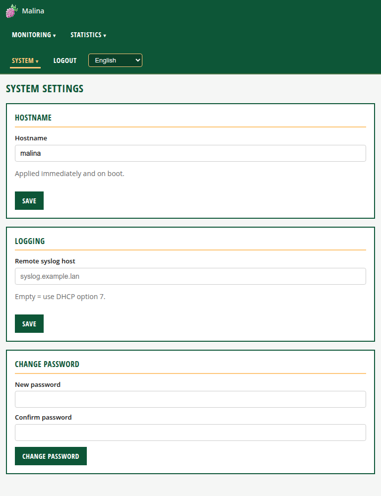
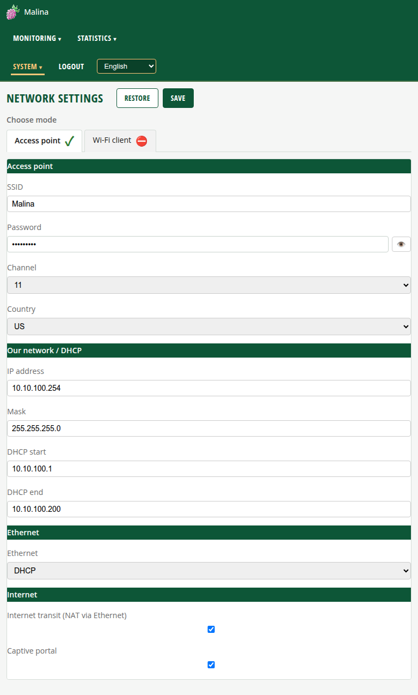
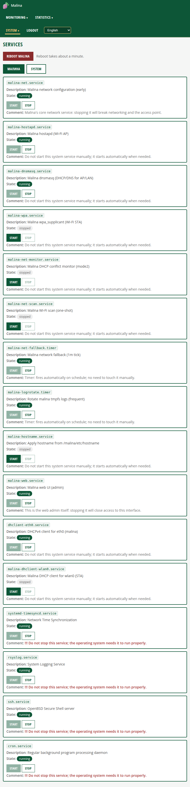

# Страницы веб-интерфейса (подробно)

Обзор UI и вход — в [ui.md](ui.md). Настройка сети — в [network.md](network.md).

---

## 1. Вход в систему (`/login`)

Вход по паролю, пользователь фиксирован (`malina`). Пароль по умолчанию —
**`malina26`**. Смена — на странице «Параметры системы». Язык переключается тут же
(вверху справа).

---

## 2. Информация о системе (`/`)

Сводка состояния. Обновляется автоматически (1 c), если включён чекбокс
**«Автообновление»** вверху справа (по умолчанию включён; выбор запоминается).
Если снять — данные «замирают».

Карточки:

- **Хост** — имя, модель, ОС, ядро, архитектура, uptime, время загрузки и текущее.
  Ниже — подраздел **«Состояние сети»** (постоянный/текущий режим, раздача DHCP,
  монитор чужого DHCP) и **«Питание»** (флаги `throttled`, напряжение ядра,
  память ARM/GPU).
  - `throttled` расшифровывается в понятные состояния: пониженное питание,
    ограничение частоты, троттлинг, софт-лимит по температуре (сейчас и «было»).
    При `0x0` — «без ограничений». **Входное напряжение** Pi не измеряет —
    доступна только детекция пониженного питания.
- **Процессор** — загрузка и температура (градусники), модель, число ядер, loadavg,
  текущая частота. Ниже — подраздел **«Память»** (Total/Used/Free/Available,
  Buffers/Cached, Swap).
- **Диски** — `/`, `/malina`, `/boot/firmware`.
- **Сеть** — шлюз, DNS и по каждому интерфейсу: MAC, MTU, скорость, адреса,
  принято/передано (и текущая скорость).
- **Сбойные юниты** — юниты systemd в состоянии `failed` (или «нет»). Список
  перезапрашивается только после сбоя/таймаута внешней команды и не чаще раза в 30 c.
- **Подключённые устройства** — **Wi-Fi-клиенты** точки доступа (имя, IP, MAC из
  аренд dnsmasq; «онлайн» — по ARP-таблице) и **USB-устройства** (`lsusb`).
- **Процессы** — полный список процессов. Сортировка радио‑кнопками
  **«по CPU» / «по памяти»**; кнопка **«Обновить»** — обновить список вручную.
  Список процессов **не обновляется автоматически** (чтобы не грузить устройство);
  фильтрация значений — с обрезкой и подсказкой полного текста.
- **Ошибки внешних команд** — появляется только при наличии ошибок/таймаутов
  (внешние команды ограничены 1 c и убиваются при превышении).

---

## 3. Параметры системы (`/system`)

- **Имя хоста** — сетевое имя устройства. Применяется сразу и на следующую загрузку.
  Инструкция: введите имя (буквы, цифры, дефис), нажмите «Сохранить».
- **Логирование** — адрес удалённого syslog-сервера.
  - Пусто → используется **адрес из DHCP (опция 7)**.
  - Укажите `host` или `host:port` → syslog шлётся на этот адрес.
- **Смена пароля** — новый пароль (мин. 4 символа). Запрещены управляющие символы,
  перевод строки и `:`. Пароль — это и SSH‑пароль пользователя `malina`, и вход в UI.
  Инструкция: введите новый пароль дважды, «Сменить пароль»; после смены используйте
  его для входа в админку и по SSH.

---

## 4. Настройка сети (`/network`)

Полное описание режимов и всех параметров — в отдельном документе **[network.md](network.md)**.

Кратко: над вкладками — «Выберите режим»; у активной вкладки зелёный **✓**, у
неактивной — красный **⛔**. Переключатель **«Режим 1 (Точка доступа)»** /
**«Режим 2 (Wi-Fi клиент)»**, поля зависят от режима. Кнопки вверху: **«Восстановить»**
(вернуть значения из конфигурации) и **«Сохранить»** (сохранить и применить —
перезапуск сети). Есть валидация полей.

---

## 5. Сервисы (`/services`)

- Вкладки **«МАЛИНА»** (службы подсистемы) и **«Системные»** (только просмотр).
- Колонки: служба, описание, состояние (бейдж), действия, комментарий.
- **Запустить/Остановить** — только для служб из вкладки «МАЛИНА» (список
  фиксирован). Системные службы — read‑only.
- Колонка **«Комментарий»** содержит категории:
  - критичные для ОС — «не останавливать»;
  - ядро сети (`malina-net`) — «остановка разорвёт сеть/AP»;
  - сама админка (`malina-web`) — «остановка закроет UI»;
  - таймеры — «работает по расписанию»;
  - управляемые скриптами — «не запускать вручную, запустится автоматически».
- Вверху — кнопка **«Перезагрузить малину»** (подтверждение), инициирует
  `systemctl reboot`.
- Таблица автообновляется (5 c).

**Страница ожидания перезагрузки.** После нажатия «Перезагрузить малину»
открывается страница с прогресс-«градусником» на 2 минуты и текстом «Ожидание
перезагрузки малины…». Каждые 5 c страница пытается переподключиться; при успехе —
переход на главную. Если за 2 минуты не удалось — «Упс… Что-то пошло не так,
после загрузки малины — обновите страницу» и таймер останавливается.

---

## 6. Логи (`/logs`)

- Выбор файла (whitelist: `syslog`, `auth.log`, `kern.log`, `user.log`, `cron.log`,
  `mail.log`, `daemon.log`, `messages`, `dpkg.log`).
- Автообновление раз в секунду, пока список прижат к низу; прокрутка вверх
  загружает историю (постранично).
- Просмотр только чтения; защита от path traversal.

---

## 7. Выход

Кнопка **«Выход»** в меню справа завершает сессию и возвращает на страницу входа.
