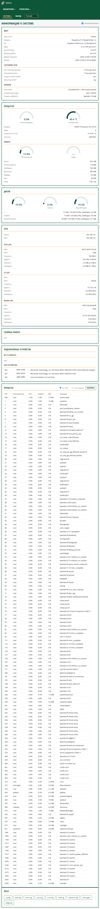

# Информация о системе (`/info`)

Сводка состояния устройства. Обновляется автоматически (раз в секунду), если
включён чекбокс **«Автообновление»** вверху справа (по умолчанию включён; выбор
запоминается в браузере). Снятие галочки «замораживает» данные.

## Карточки

- **Хост** — имя хоста, модель, ОС, ядро, архитектура, время работы (uptime),
  время загрузки и текущее время. Ниже — подразделы:
  - **Состояние сети** — постоянный и текущий режим («Точка доступа» / «Wi‑Fi клиент»),
    раздаётся ли DHCP, состояние монитора чужого DHCP.
  - **Питание** — флаги `throttled`, напряжение ядра, память ARM/GPU.
    `throttled` расшифровывается: пониженное питание, ограничение частоты,
    троттлинг, софт‑лимит по температуре (сейчас и «было»); при `0x0` — «без
    ограничений». Входное напряжение Raspberry Pi не измеряет — доступна только
    детекция пониженного питания.
- **Процессор** — загрузка и температура (градусники), модель, число ядер,
  средняя нагрузка (loadavg), текущая частота. Ниже — подраздел **Память**
  (Total/Used/Free/Available, Buffers/Cached, Swap).
- **Диски** — использование разделов `/`, `/malina`, `/boot/firmware` (объём,
  занято, свободно).
- **Сеть** — шлюз, DNS и по каждому интерфейсу: MAC, MTU, скорость, адреса,
  принято/передано (и текущая скорость).
- **Сбойные юниты** — службы systemd в состоянии `failed` (или «нет»). Список
  перезапрашивается только после сбоя/таймаута внешней команды и не чаще раза в 30 c.
- **Подключённые устройства**:
  - **Wi‑Fi‑клиенты** точки доступа — имя, IP, MAC (из аренд dnsmasq); признак
    «онлайн» — по ARP‑таблице. Сигнал/битрейт для клиентов AP недоступны;
  - **USB‑устройства** — из `lsusb`.
- **Процессы** — полный список процессов. Сортировка — радио‑кнопками
  **«по CPU»** (по умолчанию) или **«по памяти»**; кнопка **«Обновить»** справа
  обновляет список вручную. Автообновление список процессов **не затрагивает**
  (чтобы не нагружать устройство).
- **Ошибки внешних команд** — карточка появляется, если внешняя команда превысила
  лимит 1 c и была убита (или завершилась ошибкой).
