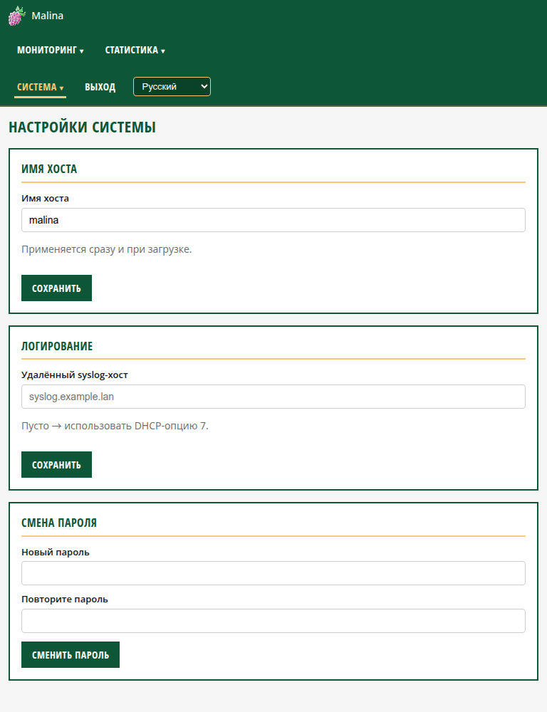

# Параметры системы (`/system`)

- **Имя хоста** — сетевое имя устройства. Применяется сразу и используется при
  следующей загрузке.
  - Инструкция: введите имя (буквы, цифры, дефис), нажмите «Сохранить».
- **Логирование** — адрес удалённого syslog‑сервера.
  - Пусто → используется адрес из **DHCP (опция 7)**.
  - Можно указать `host` или `host:port` — syslog будет отправляться туда.
- **Синхронизация времени МАП** — каждые 10 минут МАП сверяется с системными часами
  и при расхождении более 1 минуты корректируется.
- **Мониторинг** — периодическая отправка **SNMP‑трапов** на внешний приёмник
  (например, Zabbix/Nagios) для наблюдения за телеметрией МАП/КЭС по SNMP.
  - **Включить периодическую отправку** — переключатель (по умолчанию выключено).
  - **IP приёмника trap** — IPv4‑адрес (обязателен при включении).
  - **Периодичность** — интервал в секундах, **30…3600** (по умолчанию 300).
  - Порт и community у SNMP‑трапов фиксированные: **UDP 162 / `public`**, в интерфейсе
    не отображаются. За один тик отправляется по трапу на каждый телеметрический объект
    МАП и КЭС (по notification‑OID MICROART‑MIB).
  - Внешний опрос по SNMP (агент) выполняется через **UDP 161 / `public`** (v2c),
    значения отдаются по MICROART‑MIB.
- **Смена пароля** — новый пароль сразу для **двух** пользователей: `malina`
  (веб‑вход и SSH) и `root` (SSH). Минимум 4 символа; запрещены управляющие
  символы, `:` и перевод строки.
  - Инструкция и смена пароля `root`/Wi‑Fi — в общих инструкциях: [ui.md](../ui.md).
- **Управление питанием** — две кнопки с подтверждением:
  - **Перезагрузить** — корректная перезагрузка устройства (page `«Ожидание перезагрузки»`).
  - **Выключить** — корректное завершение работы (page `«Выключение»`); питание можно
    отключить после полной остановки.
