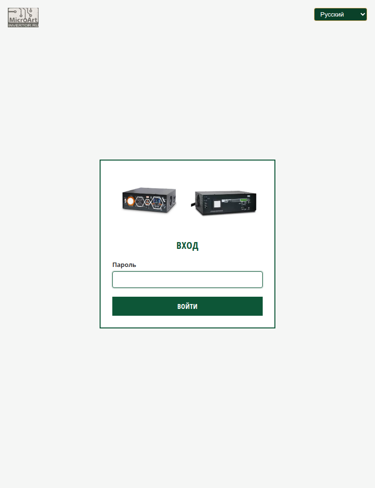

# Веб-интерфейс «Микроарт-Малина» (UI)

Веб-админка — основной способ управления ПАК «Малина»: состояние системы,
настройка сети, управление службами, журналы.

- Адрес: `http://<адрес-устройства>/` (в режиме «Точка доступа» — `http://10.10.100.254/`).
- Внешний доступ (через TLS-прокси): **`https://gmalina.duckdns.org/`**.
- **Логин по умолчанию: пользователь `malina`, пароль `malina-26`.**
- Вход — только по паролю (пользователь фиксирован). Пароль меняется на странице
  «Параметры системы».
- Языки: `Русский`, `Беларуская`, `中文`, `English`. Выбор — справа вверху; по
  умолчанию — **English**.



## Доступы по умолчанию

| Доступ | Логин | Пароль | Примечание |
|---|---|---|---|
| Веб-админка | `malina` | `malina-26` | только пароль, пользователь фиксирован |
| SSH | `malina` | `malina-26` | обычный вход |
| SSH (root) | `root` | `malina-26` | при необходимости |
| Wi-Fi (точка доступа) | SSID `Malina` | `malina-26` | WPA2 |

Пароль пользователя `malina` (веб/SSH) меняется на странице «Параметры системы».
SSID/пароль точки доступа — на «Настройка сети» → «Режим 1».

## Вход по SSH

```
ssh malina@<адрес-устройства>
```
- Адрес: в общей сети — адрес, полученный на `eth0` (например, `<адрес-в-общей-сети>`); из сети точки
  доступа — `10.10.100.254`.
- Пароль по умолчанию — `malina-26` (и у пользователя `malina`, и у `root`).
- После смены пароля в веб-админке используйте новый и для SSH.

## Подключение к точке доступа (Wi-Fi AP)

- SSID по умолчанию — **`Malina`**, защита **WPA2**, пароль — **`malina-26`**.
- Подключитесь к этой сети с телефона/ноутбука. Адрес выдаётся автоматически из
  нашей подсети (`10.10.100.0/24`), шлюз — `10.10.100.254`.
- Веб-админка доступна по `http://10.10.100.254/`.
- Для интернета у клиентов должен быть включён NAT (`Internet transit (NAT)`) на
  странице «Настройка сети».
- Сменить SSID/пароль/канал: «Настройка сети» → вкладка **«Режим 1»** → «Сохранить».

> По умолчанию устройство работает в режиме **«Точка доступа»**. Второй режим —
> «Wi-Fi клиент» (устройство само подключается к внешней сети) — см.
> [pages/network.md](pages/network.md).

## Смена паролей

Корневая файловая система устройства смонтирована **только для чтения (`ro`)**,
поэтому смена пароля выполняется через helper `malina-rw`, который на время
команды перемонтирует корень в `rw` и возвращает `ro`. Обычный `passwd` напрямую
**не сработает** («Ошибка при операциях с маркером проверки подлинности»).

- **Веб-вход и SSH пользователя `malina`** — страница «Параметры системы» →
  «Смена пароля» (мин. 4 символа; запрещены управляющие символы, `:` и перевод
  строки). Этот же пароль действует для SSH‑входа `malina`.
  Через SSH: `sudo /malina/usr/local/sbin/malina-rw run passwd malina`.
- **Пароль `root` (SSH)** — по SSH под `root`:
  ```
  /malina/usr/local/sbin/malina-rw run passwd root
  ```
  Без интерактива (одной строкой):
  ```
  printf 'root:НОВЫЙ_ПАРОЛЬ\n' | /malina/usr/local/sbin/malina-rw run chpasswd
  ```
- **Пароль точки доступа Wi‑Fi** — «Настройка сети» → «Режим 1» → `Password`.
- **Пароль внешней сети (режим «Wi‑Fi клиент»)** — «Настройка сети» → «Режим 2» →
  `Password`.

Пароли по умолчанию: `malina` и `root` — `malina-26`; точка доступа Wi‑Fi — `malina-26`.

> Описание страниц — раздел «Страницы» ниже; настройка сети —
> [pages/network.md](pages/network.md).

## Структура меню

- **МОНИТОРИНГ ▾** — `МАП` (реальная страница; при нескольких МАП — по ссылке на каждый),
  `КЭС` (задел под будущие разделы; пока заглушка).
- **СТАТИСТИКА ▾** — `Графики`, `Агрегаты` (задел).
- **СИСТЕМА ▾** — `Информация о системе`, `Параметры системы`, `Настройка сети`, `Сервисы`.
- **ВЫХОД** — завершение сессии.

«Мониторинг» и «Статистика» — по центру; «Система» и «Выход» — справа.

## Общие принципы

- Страницы, где есть **автообновление** («Информация», «Логи»), опрашивают сервер
  раз в секунду, пока вкладка прижата к низу/пока включён чекбокс. На «Информации»
  автообновление можно **отключить** чекбоксом вверху справа (выбор запоминается).
- Состояния служб показываются цветными бейджами: зелёный — работает, серый —
  остановлена, красный — сбой.
- Все внешние команды на сервере выполняются с лимитом **1 c** (зависшие —
  убиваются); если такие события есть, на «Информации» появляется карточка
  «Ошибки внешних команд».

## Страницы

- [Информация о системе](pages/info.md) — `/`
- [МАП](pages/map.md) — `/map` (таблицы «Монитор», «Информация», «Управление»)
- [Параметры системы](pages/system.md) — `/system`
- [Настройка сети](pages/network.md) — `/network`
- [Сервисы](pages/services.md) — `/services`
- [Логи](pages/logs.md) — `/logs`
